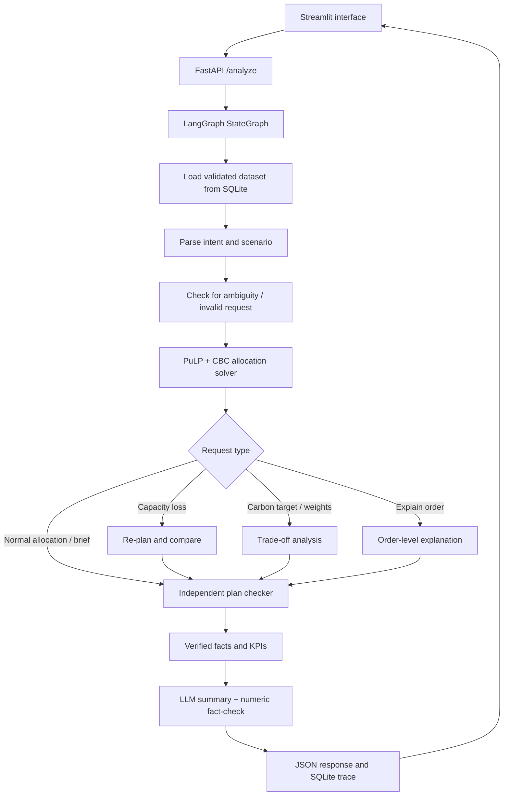

# CarbonWise Allocator

**AI-assisted multi-plant order allocation with cost and carbon optimization**

CarbonWise Allocator is a full-stack application. It allocates manufacturing orders across three plants while balancing landed cost, carbon emissions, production capacity, product eligibility, and delivery deadlines. Users can ask natural-language questions, explore cost–carbon trade-offs, and re-plan after a capacity disruption. **Plans and numerical KPIs come from the optimization engine; the LLM interprets requests and explains verified results.**

## Tech stack

| Layer | Technologies |
| --- | --- |
| Frontend | Python, Streamlit, Plotly |
| Backend/API | FastAPI, Uvicorn, Pydantic v2 |
| Workflow orchestration | LangGraph |
| Optimization | PuLP, CBC (mixed-integer linear programming) |
| Data and persistence | pandas, SQLite |
| Natural-language interface | Configurable LLM (Ollama/OpenAI/Anthropic/Gemini) or deterministic mock mode |
| Packaging and testing | Docker, Docker Compose, pytest |

## Key features

- **Multi-objective allocation:** assigns orders to eligible plants, weighing landed cost and carbon emissions while enforcing production capacity and delivery constraints.
- **Detailed costing and emissions:** accounts for manufacturing, electricity, transportation, import duty, and the carbon footprint of energy and shipping.
- **Scenario analysis:** evaluates carbon-reduction targets and alternative cost/carbon weights.
- **Capacity-loss replanning:** rebuilds the plan after dated reductions in plant capacity and compares it with the baseline.
- **Independent plan validation:** separately checks order coverage, product eligibility, manufacturing quantities, capacity, delivery dates, cost, emissions, and KPIs.
- **Natural-language explanations:** LangGraph coordinates parsing, optimization, checking, and the LLM-generated management summary; computed claims are fact-checked, with a deterministic fallback.
- **Audit and ingestion:** versioned CSV inputs, SQLite run records, and an endpoint to inspect each execution trace.

## Architecture



The graph is implemented in `app/graph/workflow.py`. It has explicitly defined nodes, shared `WorkflowState`, conditional edges, and safe error/clarification/refusal paths. It is **not** a collection of autonomous agents: deterministic tasks use Python tools; language-specific tasks use the configured LLM when enabled.

## Getting started

### Option A: Docker Compose (recommended)

Prerequisites: **Docker** and **Docker Compose**.

```bash
# Optional: configure a live LLM; no key is needed for mock mode
cp .env.example .env

docker compose up --build
```

- **Dashboard:** http://localhost:8501
- **API:** http://localhost:8000
- **Interactive API docs:** http://localhost:8000/docs

The default Docker Compose configuration uses `MOCK_LLM=true`, so the application can run without a hosted API key or an Ollama model. In this mode, parsing and summaries use deterministic fallbacks, **not an external LLM**. SQLite data is persisted in the `carbonwise-db` Docker volume.

Stop the services with `docker compose down`. Avoid `docker compose down -v` unless you intend to delete the database volume.

### Option B: Run locally

Prerequisites: **Python 3.11+** and pip (the bundled CBC solver must be available on your platform).

```bash
python -m venv .venv
# macOS/Linux: source .venv/bin/activate
# Windows PowerShell: .venv\Scripts\Activate.ps1
python -m pip install -r requirements.txt
```

Enable deterministic mode in your terminal if you don't have an LLM configured:

```bash
# macOS/Linux
export MOCK_LLM=true
# Windows PowerShell equivalent: $env:MOCK_LLM="true"
```

Start the backend:

```bash
python -m uvicorn app.api.main:app --host 127.0.0.1 --port 8000
```

In a second terminal (with the same Python environment):

```bash
python -m streamlit run ui/app.py
```

On first startup, the backend can seed an empty SQLite database from the **synthetic** CSV files in `carbonwise-data/synthetic_data/main/`. The default local database is created under `carbonwise-data/data/` and excluded from Git.

**LLM configuration:** `.env.example` lists `MOCK_LLM`, `LLM_PROVIDER`, `LLM_MODEL`, provider API key names, Ollama URL, and solver limits. Docker Compose loads an optional `.env` file. **For local Python runs, export the desired environment variables in your terminal**; the app does not automatically import `.env` on startup. Never commit actual credentials.

## Example questions

Try these in the Streamlit request box:

- `Allocate this week's orders.`
- `What is the cheapest plan that is on time?`
- `Plant B loses 30% capacity for two weeks. Re-plan.`
- `What does a 10% carbon cut cost?`
- `Why was order ORD-0001 assigned to Plant C?`
- `Write a brief for the leadership team.`

## API endpoints

| Method | Endpoint | Purpose |
| --- | --- | --- |
| `GET` | `/health` | Check API, database, solver, and LLM mode |
| `POST` | `/analyze` | Parse a question, solve and validate a plan, return structured KPIs and explanation |
| `POST` | `/ingest` | Validate and ingest a CSV dataset table |
| `GET` | `/trace/{run_id}` | Retrieve the workflow trace of a completed run |

Example:

```bash
curl -X POST http://localhost:8000/analyze \
  -H "Content-Type: application/json" \
  -d '{"request":"Plant B loses 30% capacity for two weeks. Re-plan."}'
```

Load a synthetic CSV table:

```bash
curl -X POST http://localhost:8000/ingest \
  -F 'file=@carbonwise-data/synthetic_data/main/capacity_events.csv' \
  -F 'meta={"table":"capacity_events"}'
```

API results include a `run_id`, an `answer_type`, solver-computed allocations and KPIs when applicable, validation status, assumptions/limitations, and explanations. The scenario comparison fields are populated for scenario requests.

## How the optimization works

The `carbonwise-data/optimization/` package implements an integer programming model:

- A **binary variable** chooses the plant and dispatch date for each order.
- **Integer production variables** schedule the ordered units on individual production days at the chosen plant.
- **Hard constraints** enforce product eligibility, shared daily plant capacity, quantity fulfillment, production-before-dispatch, and on-time arrival in strict mode.
- The **objective** minimizes a normalized weighted combination of landed cost and carbon emissions (default weights: 70% cost, 30% carbon). Weights express business priorities, not guaranteed savings.

Landed cost includes **production + energy + transport + duty**. Carbon calculations include **energy-related and transport emissions**. Strict infeasibility is reported as such; the optimizer can construct an explicitly labeled diagnostic alternative rather than silently claiming the original deadlines were satisfied.

The independent checker in `optimization/checker.py` recomputes feasibility and numerical reporting from the input data and proposed schedule. It validates correctness but **does not independently prove global optimality**; that proof belongs to the solver when available.

## Repository layout

```text
.
├── app/
│   ├── api/                  # FastAPI endpoints
│   ├── graph/                # LangGraph workflow and response assembly
│   ├── llm/                  # Request parser, provider client, factual writer
│   ├── services/             # Dataset integration
│   └── tests/                # Application and workflow tests
├── ui/                       # Streamlit dashboard and API client
├── carbonwise-data/
│   ├── optimization/         # PuLP model, cost/carbon, scenarios, checker
│   ├── services/             # Data ingestion and validation
│   ├── storage/              # SQLite repositories and persisted solver runs
│   ├── scripts/              # Synthetic data, evaluation and optimizer CLI
│   ├── synthetic_data/       # Synthetic CSV inputs and regression fixtures
│   ├── evaluation/           # Saved evaluation JSON and example traces
│   ├── config/               # Planning assumptions and scenario example
│   └── tests/                # Data and optimizer tests
├── .env.example              # Safe environment-variable template
├── .gitignore
├── Dockerfile
├── docker-compose.yml
└── requirements.txt
```

## Optimizer CLI and testing

From the repository root:

```bash
# Complete Python test suite
python -m pytest -q app/tests carbonwise-data/tests

# Standalone optimizer and example workflows
python carbonwise-data/scripts/run_optimizer.py
python carbonwise-data/scripts/run_optimizer.py --mode tradeoffs
python carbonwise-data/scripts/run_optimizer.py --mode replan \
  --events-json carbonwise-data/config/capacity_scenario.example.json
python carbonwise-data/scripts/run_optimizer.py --mode explain --order-id ORD-0001
```

The CLI stores generated results under `carbonwise-data/data/`, which is excluded from Git. Evaluation inputs and recorded reports are available as JSON in `carbonwise-data/evaluation/`.

## Data provenance, assumptions and limitations

- Data in this repository is **synthetic**, not real customer or company data. It is suitable for demo/testing, not production planning decisions.
- The bundled generation script uses a fixed seed (`42`) for reproducibility and includes multiple plants, destinations, product capabilities and disruption scenarios.
- The source CSV schema does not specify electricity prices. The planning configuration therefore uses **explicit synthetic electricity-price assumptions**, currently A ₹8/kWh, B ₹6/kWh and C ₹7/kWh.
- The source plant/product rows have inconsistent weekly capacity values. The configuration sets **conservative shared plant capacities** of A 850, B 760 and C 640 units/week. These are assumptions rather than validated real-world limits.
- `capacity_loss_pct` and duty values use **fractions**: `0.30` means 30%. `carbon_cut_pct` uses percentage points: `10` means 10%.
- The model uses a daily quantity/capacity approximation. It does not model machine setups, detailed routing or inventory holding costs. Early production may occur before dispatch.
- Saved evaluation files document specific local tests; they are not a guarantee of performance on unseen datasets or hardware.
